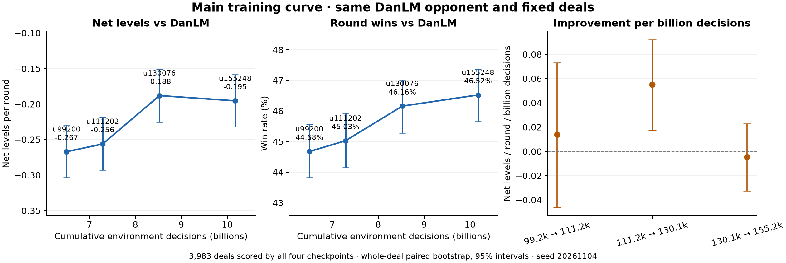

# Main strength curve — November 8, 2026

Four main checkpoints were compared against original DanLM v1 on the same
4,000 fixed deals (seed 20261104, tribute fraction 0.5), each played twice
with teams swapped. The u99200 and u130076 runs were added for this analysis;
u111202 and u155248 reuse the existing reports. u130076 was the closest
available saved checkpoint above u130000.

All comparisons and the figure below use the 3,983 deals scored by all four
checkpoints, preserving both legs per deal. Thus means differ slightly from
the separate endpoint reports. Arena source and deal hashes match across
all four inputs. The added runs excluded 4 and 7 deals respectively for
their_choice_missing; raw failed-leg records remain available.

| Update | Cumulative decisions, billions | Net levels/round | Round wins |
|---|---:|---:|---:|
| 99200 | 6.501 | −0.26701 | 44.677% |
| 111202 | 7.288 | −0.25609 | 45.029% |
| 130076 | 8.525 | −0.18805 | 46.159% |
| 155248 | 10.174 | −0.19546 | 46.523% |

| Interval | Additional decisions, billions | Net-level gain/round (95% CI) | Win-rate change, pp (95% CI) |
|---|---:|---:|---:|
| 99200 → 111202 | 0.787 | +0.01092 [−0.03616, +0.05738] | +0.351 [−0.766, +1.469] |
| 111202 → 130076 | 1.237 | +0.06804 [+0.02146, +0.11386] | +1.130 [0.000, +2.222] |
| 130076 → 155248 | 1.650 | −0.00741 [−0.05398, +0.03779] | +0.364 [−0.728, +1.444] |

Net-level improvement per billion decisions was +0.01388, +0.05501 and
−0.00449 respectively. The last slope minus the middle slope was −0.05950
(95% paired-bootstrap interval −0.11503 to −0.00132). This supports slowing
relative to the preceding interval, with a borderline pointwise interval.
The last slope versus the first interval remains uncertain.

The latest interval added 1.650 billion decisions without a detectable
net-level or win-rate improvement. A recent plateau is plausible; four
checkpoints on one reused comparison set do not establish a permanent
ceiling or a monotonically slowing learning curve. Latest versus u111202
still has the improvement reported separately. No training change was made.

Bootstrap resampled whole common deals jointly across all checkpoints,
5,000 replicates with seed 0, pointwise percentile 95% intervals without
multiplicity correction. Slopes divide paired score changes by actual
decision-count differences. The graph connects measured endpoints only.

[Machine-readable summary](data/main-curve-2026-11-08.json) records checkpoint
and source artifact identities. Raw added evaluations, analysis and plot
scripts live in ignored `.work/main-curve-2026-11-08/`; the other two
input reports are linked by path in the summary. The source/deal identities
and older evaluation protocol are described in the
[endpoint report](main-league-danlm-2026-11-04.md).
